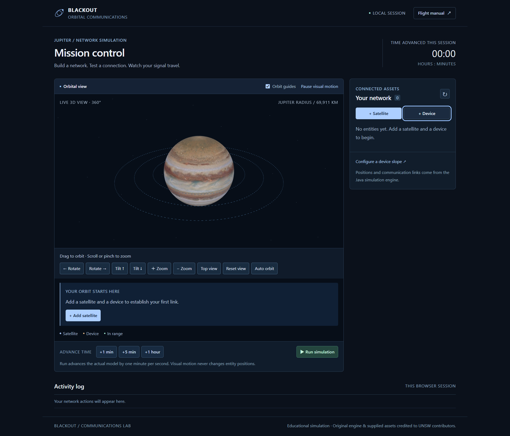

# Blackout — Orbital Communications

Build a network of devices and satellites around Jupiter, inspect communication links and follow bandwidth-limited file transfers.

Maintained by **Weihou Zeng (PeterZG)**.



## Features

- Handheld, laptop and desktop devices.
- Standard, relay and teleporting satellites.
- Range and line-of-sight communication checks.
- File transfers with storage limits, bandwidth sharing and interruption handling.
- Manual time steps and automatic simulation.
- Entity inspection and repositioning, file reading/editing/deletion, transfer progress and an activity log.
- Real WebGL 3D Jupiter with 360° orbit, pole-to-pole camera tilt, zoom, reset and optional automatic orbit.
- Mouse, touch and keyboard camera controls, with a separate visual-motion control.

The Java engine advances in one-minute steps. Decorative animation does not change model positions. The clock shows time advanced during the current browser session.

## Technology and structure

Java 17 and Gradle power the simulation. The browser uses HTML, CSS and JavaScript modules, Three.js/WebGL and OrbitControls. esbuild produces one browser bundle from the readable modules.

```text
app/src/main/java/
  unsw/App.java                    HTTP and session handling
  unsw/blackout/                   Simulation and active transfers
  unsw/item/                       Devices, satellites and files
  unsw/utils/                      Angles and geometry
  unsw/response/models/            API responses
app/src/main/resources/app/
  index.html                      Interface structure
  mission-control.css             Layout and styling
  mission-control.js              Interface state and interactions
  simulation-api.js               Requests to Java
  orbital-scene.js                3D scene, camera and entity labels
app/build/generated/frontend/     Generated browser bundle (not source)
app/src/test/blackout/             Java tests
scripts/browser-check.cjs          Browser tests
```

## Build and run

Install JDK 17+ and Node.js 22+ with npm:

```sh
./gradlew run
```

On Windows, use `gradlew.bat`. Open `http://127.0.0.1:4567/app/`.

Gradle installs the locked npm dependencies and builds the browser bundle before packaging or starting Java. The first build needs access to the dependency registries. For frontend-only build work, run `npm ci` followed by `npm run build`.

The server binds to the local machine by default. For a different port in PowerShell:

```powershell
[Environment]::SetEnvironmentVariable('scintilla:PORT','4577','Process')
[Environment]::SetEnvironmentVariable('scintilla:HEADLESS','1','Process')
.\gradlew.bat run
```

## Your first transfer

1. Add a **Handheld Device** at 0°.
2. Add a **Standard Satellite** at 0° with an orbital radius of 80,000 km.
3. Select the device and add `telemetry.txt` containing `Hello Jupiter`.
4. Choose **Send file** and select the satellite.
5. Inspect the destination and use **+1 min** or **Run simulation** to advance the transfer.

Orbital radius is measured from Jupiter's centre. The Standard satellite receives one character per minute, so the example file takes multiple steps.

**Pause visual motion** controls decorative effects only. **Run simulation** advances the Java model by one simulated minute per second.

## Explore in 3D

Drag the view to orbit around Jupiter, including its far side. Scroll or pinch to zoom. Use **Tilt** to see either pole, **Top view** for the simulation plane, and **Reset view** to recover the initial camera. All camera actions also have buttons. Focus the view and use arrow keys, +/− or Home for keyboard control.

Camera movement never changes simulation data. The original model places entities on one orbital plane; the 3D renderer does not invent inclinations or new physics. Far-side entities are hidden by Jupiter and remain available in the network list.

Select an entity to edit its position or radius. This cancels its active transfers but preserves completed files. Device files can be read, edited and deleted; files with outgoing transfers must finish before editing. Deleting an active source removes unfinished destination copies, not completed copies on other entities.

Empty text files are supported. Returning through browser history refreshes the network and restores 3D rendering; simulation time stays paused until **Run simulation** is selected again.

## Tests

```sh
./gradlew test lint assemble
npm ci
npm run test:browser
```

The browser script expects Java on port 4577 and uses Chrome by default. Override `QA_BASE_URL` or `BROWSER_CHANNEL` as needed. It exercises the real Java API in isolated browser sessions.

The Java test source set includes `app/src/test/blackout/`.
HTTP value parsing is covered by `app/src/test/unsw/SimulationInputTests.java`. Invalid moving-device flags, non-finite positions/radii and fractional or out-of-range simulation steps are rejected before mutation. Browser checks also exercise delayed failed selection requests and actual back-forward-cache restoration.

## Limitations

Browser regressions check UI text size (at least 16px), contrast, six viewport widths, 200% enlargement and native browser zoom. Long names wrap in the scene and network list. Text over textures also needs screenshot review. The GitHub workflow builds and tests Java and the browser bundle, starts the packaged application, runs simulation flows and saves screenshots. The retained `.gitlab-ci.yml` is for the original course runner. No pipeline deploys publicly; remote CI conclusions need separate verification.

State is in memory and expires after one hour without activity. Restarting the server clears sessions. File size follows the model's character-count rules. 3D rendering requires WebGL 2; network controls remain available if graphics are unavailable. The web server is intended for local use, not public multi-user hosting.

[中文说明](README_zh.md) · [Code guide](CODE_GUIDE.md)
